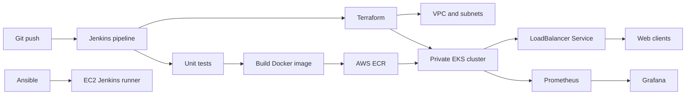

End-to-End DevOps Pipeline for a Web Application
Project Overview

I am developing an end-to-end DevOps pipeline for a web application to automate the complete software delivery lifecycle, from code testing and containerization to deployment, monitoring, and scaling on AWS. This project demonstrates practical implementation of CI/CD, Infrastructure as Code (IaC), containerization, Kubernetes orchestration, configuration management, and observability using industry-standard DevOps tools.

The solution utilizes Jenkins for Continuous Integration and Continuous Deployment (CI/CD), Terraform for AWS infrastructure provisioning, Ansible for configuration management, Docker for containerization, Amazon Elastic Kubernetes Service (EKS) for orchestration, and Prometheus with Grafana for monitoring and alerting.

Architecture

In this project, I have designed a secure and scalable AWS-based architecture where:

Jenkins orchestrates the entire deployment workflow.
A dedicated Jenkins runner operates inside the AWS VPC to access the private EKS API endpoint.
Terraform provisions AWS infrastructure including VPC, EKS, node groups, ECR repositories, and networking components.
Ansible configures Ubuntu-based Jenkins runner instances.
Docker packages the application into lightweight containers.
Amazon EKS hosts and manages Kubernetes workloads.
Prometheus collects metrics from applications and Kubernetes resources.
Grafana visualizes system health and performance dashboards.
Horizontal Pod Autoscaler (HPA) automatically scales application pods based on resource utilization.

To maintain security best practices:

The EKS API endpoint remains private.
Jenkins controller access is restricted.
AWS credentials are managed through IAM roles rather than static access keys.
Sensitive data such as secrets, passwords, Terraform states, and SSH keys are excluded from source control.



The Jenkins runner must have network access to the private EKS API endpoint, usually by running in the VPC. EKS managed nodes are configured by EKS, not Ansible. The Ansible playbook targets a separate Ubuntu EC2 Jenkins runner. Jenkins itself and its ingress/security group are intentionally managed separately so this starter does not expose a new controller to the public internet.

## Repository Layout

| Path | Purpose |
| --- | --- |
| `app/` and `tests/` | Dependency-free WSGI app, health endpoints, metrics, and unit tests |
| `Dockerfile` | Non-root application container with a health check |
| `Jenkinsfile` | Test, build, ECR push, optional gated Terraform, Ansible, EKS deploy, and smoke-test stages |
| `terraform/bootstrap/` | One-time creation of the encrypted, versioned Terraform state bucket |
| `terraform/` | VPC, private EKS cluster, managed node group, ECR, and remote state |
| `ansible/` | Ubuntu Jenkins runner setup and inventory example |
| `k8s/` | Namespace, deployment, load balancer, HPA, ServiceMonitor, and alert rules |
| `monitoring/` | `kube-prometheus-stack` Helm values and application alerts |

## Prerequisites

- AWS account and CLI authenticated with AWS IAM Identity Center/SSO or an instance profile.
- Docker, Terraform 1.10+, AWS CLI v2, `kubectl`, Helm, Python 3.12+, and Ansible on the Jenkins agent or local workstation as applicable.
- A Jenkins controller with Pipeline, Git, and Multibranch Pipeline support, plus an isolated Linux agent labeled `docker-terraform-aws`.
- A globally unique S3 bucket name for Terraform state. The state bucket is deliberately bootstrapped separately because a backend cannot create itself.

Do not put AWS access keys, SSH private keys, Terraform state, or Grafana passwords in Git. Prefer IAM roles/instance profiles and Jenkins secret credentials. Restrict the controller UI and agent access to trusted networks.

## Run Locally

```powershell
python -m unittest discover -s tests -v
docker build -t capstone-web:local .
docker run --rm -p 8080:8080 capstone-web:local
```

Check `http://localhost:8080/`, `/healthz`, `/readyz`, and `/metrics`.

## Provision AWS

Choose a unique bucket name and region. The bootstrap state is local; protect and back it up as you would any Terraform state.

```powershell
Set-Location terraform/bootstrap
terraform init
terraform apply -var="state_bucket_name=YOUR-UNIQUE-STATE-BUCKET" -var="aws_region=us-east-1"
Set-Location ..
terraform init -backend-config="bucket=YOUR-UNIQUE-STATE-BUCKET" -backend-config="region=us-east-1"
terraform validate
terraform plan -out=tfplan
terraform apply tfplan
```

The main stack creates two public and two private subnets across two availability zones, one NAT gateway by default, a private EKS API endpoint, two `t3.medium` managed nodes, and a private ECR repository with scan-on-push and image retention. Set `single_nat_gateway=false` in a reviewed `.tfvars` file for more AZ-level NAT resilience at higher cost. The cluster version is configurable in `terraform/variables.tf`; confirm regional EKS support before applying.

The private endpoint is not reachable from a typical laptop. Run `kubectl`, Jenkins deployment stages, and Terraform operations from a network path inside the VPC. Terraform creates billable resources. Review every plan, monitor AWS Budgets, and destroy the main stack when finished. The separate state bucket is retained so state is not accidentally destroyed with the cluster.

## Jenkins Setup

Create a Multibranch Pipeline for this repository. Configure a Linux agent with the label `docker-terraform-aws` and install Docker, Python 3, Terraform, AWS CLI v2, `kubectl`, Helm, and Ansible on that agent. Install Jenkins Pipeline, Git, and Multibranch Pipeline plugins. This implementation uses the CLIs and an EC2 instance profile rather than Docker/Kubernetes/AWS credential plugins, avoiding long-lived cloud keys in Jenkins. Give the instance profile only the permissions needed for ECR push/pull, EKS access, Terraform's VPC/EKS/IAM operations, and the named state bucket. Ensure agent-to-EKS private API networking works.

Install the Credentials Binding plugin for the Grafana credential and Email Extension (`email-ext`) only if pipeline failure email is required. Create a Jenkins username/password credential with ID `monitoring-grafana`; the Monitoring stage uses it to create/update the Kubernetes Secret. For job-failure email, configure SMTP in Jenkins and provide `NOTIFICATION_EMAIL` at build time.

The pipeline parameters are:

- `AWS_REGION`, `EKS_CLUSTER_NAME`: target AWS deployment.
- `TF_STATE_BUCKET`: the bucket created by the bootstrap stack.
- `ANSIBLE_INVENTORY`: private inventory path for the optional runner-configuration stage.
- `RUN_INFRASTRUCTURE`: off by default. Turn on for a reviewed Terraform plan; a separate Jenkins approval is required before apply.
- `RUN_CONFIGURATION`: off by default. Turn on only after creating the private `ansible/inventory.ini` from the example and preparing SSH access.
- `NOTIFICATION_EMAIL`: optional Jenkins job-failure recipient; requires the email-ext plugin and configured SMTP.

On `main`, the pipeline tests and builds every commit. ECR push and EKS deployment run after infrastructure exists. The image is tagged with the Jenkins build number; ECR tags are immutable. Do not use a shared static AWS key in Jenkins.

## Ansible Runner Setup

Copy `ansible/inventory.example.ini` to the ignored `ansible/inventory.ini`, replace the example host with a private EC2 address, and arrange SSH access outside Git. Install Ansible on the controller/agent that executes the playbook, then run:

```powershell
ansible-playbook -i ansible/inventory.ini ansible/site.yml --check
ansible-playbook -i ansible/inventory.ini ansible/site.yml
```

The playbook installs Docker, AWS CLI, Terraform, `kubectl`, and Git on an Ubuntu x86_64 runner. The Jenkins agent user must exist. Adding a user to the Docker group grants root-equivalent privileges; use only on a dedicated, trusted runner and prefer an isolated/ephemeral build agent for production.

## Kubernetes and Monitoring

The Jenkins pipeline deploys the namespace, application, LoadBalancer Service, Metrics Server, kube-prometheus-stack, HPA, ServiceMonitor, and Prometheus alert rules. To install these manually, first create the `monitoring-grafana` Secret using a Jenkins credential or another secret manager, then run:

```powershell
helm repo add prometheus-community https://prometheus-community.github.io/helm-charts
helm repo update
kubectl apply -f https://github.com/kubernetes-sigs/metrics-server/releases/download/v0.8.0/components.yaml
kubectl create namespace monitoring
helm upgrade --install monitoring prometheus-community/kube-prometheus-stack -n monitoring -f monitoring/prometheus-values.yaml
kubectl apply -f k8s/autoscaling.yaml
kubectl apply -f k8s/servicemonitor.yaml
kubectl apply -f monitoring/alerts.yaml
```

Keep the Grafana password out of shell history in shared environments; provision it through a secret manager or Jenkins credential. Confirm the `metrics-server` API is available for the HPA with `kubectl top nodes`. Access Grafana through a private port-forward or an authenticated ingress; do not expose it directly.

The Prometheus rules currently evaluate and appear in Prometheus, but no Alertmanager email/chat receiver is configured. Configure Alertmanager with a secret-backed receiver and test delivery before relying on alerts. Jenkins job failures can send email when `NOTIFICATION_EMAIL` is set; Jenkins build metrics are not currently scraped into Prometheus/Grafana.

## Readiness Checklist

This repository provides the application and automation definitions, but it is not a one-click production deployment. Complete these environment-dependent gates before presenting the project as end-to-end ready:

- Create and secure the S3 state bucket with `terraform/bootstrap`; back up its local bootstrap state.
- Provision a restricted Jenkins controller and a Linux build agent in the VPC. Controller and agent EC2 provisioning, inbound access controls, Git webhook configuration, and IAM policies are intentionally external to this repo.
- Give the agent the documented tools, IAM instance profile, private EKS API network path, and Jenkins label. Create the `monitoring-grafana` Jenkins credential; configure optional SMTP/email.
- Run Terraform plan and apply from the Jenkins agent or another VPC-connected host; then verify ECR push, EKS rollout, load balancer access, HPA metrics, and Prometheus scrape targets.
- Configure and test an Alertmanager receiver. Add Jenkins metrics scraping if the rubric requires Jenkins job health in Grafana.
- Perform an end-to-end run and capture screenshots/logs for the presentation. This environment did not execute AWS provisioning, Jenkins, or Ansible integration tests.

## Validation and Troubleshooting

- Tests: `python -m unittest discover -s tests -v`.
- Container: `docker build -t capstone-web:local .`; run and check `/healthz`.
- Terraform: `terraform fmt -check -recursive`, `terraform validate`, and a reviewed `terraform plan`.
- EKS access: confirm the agent is in the VPC, has the expected IAM role, and can run `aws eks update-kubeconfig` and `kubectl get nodes`.
- Pods: `kubectl get pods,svc,hpa -n capstone`; inspect `kubectl describe pod` and `kubectl logs` for image pull or probe failures.
- Metrics: `kubectl port-forward -n capstone svc/capstone-web 8080:80`, then open `http://localhost:8080/metrics`; verify the ServiceMonitor target in Prometheus.
- If an HPA reports unknown CPU metrics, check Metrics Server first. If Prometheus has no application target, confirm the ServiceMonitor CRD is installed, its `release: monitoring` label is retained, and the app Service port is named `http`.

## Cost and Scope

The default one-NAT topology reduces but does not eliminate cost. EKS control plane, EC2 nodes, NAT Gateway hours/data, load balancers, EBS, and monitoring resources can all incur charges. Stop/destroy the lab stack promptly, set an AWS Budget alert, and retain the state bucket separately. For a classroom demo this intentionally uses one AWS cloud; “multi-cloud” in the supplied brief conflicts with its detailed AWS/EKS requirements and is not implemented here.

For a production service, add TLS and DNS, WAF/edge controls, private-only administration, image signing and vulnerability gates, secret management, backup/restore drills, and environment promotion policies before exposing it to customers.
