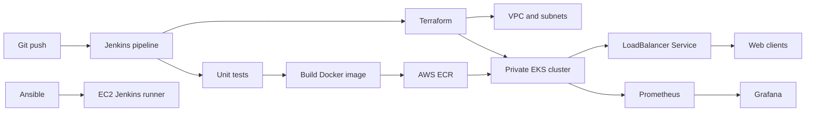

End-to-End DevOps Pipeline for a Web Application
Project Overview

I am developing an end-to-end DevOps pipeline for a web application to automate the complete software delivery lifecycle, from code testing and containerization to deployment, monitoring, and scaling on AWS. This project demonstrates practical implementation of CI/CD, Infrastructure as Code (IaC), containerization, Kubernetes orchestration, configuration management, and observability using industry-standard DevOps tools.

The solution utilizes Jenkins for Continuous Integration and Continuous Deployment (CI/CD), Terraform for AWS infrastructure provisioning, Ansible for configuration management, Docker for containerization, Amazon Elastic Kubernetes Service (EKS) for orchestration, and Prometheus with Grafana for monitoring and alerting.

Architecture

In this project, I have designed a secure and scalable AWS-based architecture where:

Jenkins orchestrates the entire deployment workflow.
A dedicated Jenkins runner operates inside the AWS VPC to access the private EKS API endpoint.
Terraform provisions AWS infrastructure including VPC, EKS, node groups, ECR repositories, and networking components.
Ansible configures Ubuntu-based Jenkins runner instances.
Docker packages the application into lightweight containers.
Amazon EKS hosts and manages Kubernetes workloads.
Prometheus collects metrics from applications and Kubernetes resources.
Grafana visualizes system health and performance dashboards.
Horizontal Pod Autoscaler (HPA) automatically scales application pods based on resource utilization.

To maintain security best practices:

The EKS API endpoint remains private.
Jenkins controller access is restricted.
AWS credentials are managed through IAM roles rather than static access keys.
Sensitive data such as secrets, passwords, Terraform states, and SSH keys are excluded from source control.

Repository Structure
Directory/File	Purposeapp/	Web application source code
tests/	Unit test cases
Dockerfile	Builds a secure non-root Docker image
Jenkinsfile	Complete CI/CD pipeline implementation
terraform/bootstrap/	Creates Terraform state bucket
terraform/	AWS infrastructure provisioning
ansible/	Jenkins runner configuration
k8s/	Kubernetes deployment manifests
monitoring/	Prometheus and Grafana configuration
Technologies Used
Cloud Platform
Amazon Web Services (AWS)
DevOps Tools
Jenkins
Terraform
Ansible
Containerization
Docker
Container Orchestration
Amazon EKS
Kubernetes
Monitoring & Observability
Prometheus
Grafana
Programming Language
Python 3.12
AWS Services
Amazon EKS
Amazon ECR
Amazon EC2
Amazon S3
IAM
VPC
CloudWatch (optional integration)
Key Features
Continuous Integration

I have implemented CI processes that:

Automatically trigger on code commits.
Execute unit tests.
Validate infrastructure code.
Build Docker images.
Generate deployment artifacts.
Continuous Deployment

The deployment pipeline:

Pushes images to Amazon ECR.
Updates Kubernetes deployments.
Applies infrastructure changes.
Performs smoke testing after deployment.
Infrastructure as Code

Using Terraform, I provision:

VPC
Public Subnets
Private Subnets
NAT Gateway
Route Tables
Security Groups
Amazon EKS Cluster
Managed Worker Nodes
Amazon ECR Repository
Remote Terraform State Backend
Configuration Management

Using Ansible, I automate:

Docker installation
Terraform installation
AWS CLI installation
kubectl setup
Git installation
Required package dependencies
Containerization

Using Docker:

The application runs in isolated containers.
Health checks monitor container health.
Non-root users enhance security.
Images are version controlled and stored in ECR.
Kubernetes Deployment

The platform includes:

Namespaces
Deployments
LoadBalancer Services
Horizontal Pod Autoscaling
ServiceMonitor Integration
Health and Readiness Probes
Monitoring & Alerting

Prometheus collects:

Application metrics
Kubernetes metrics
Resource utilization
Health status

Grafana provides:

Infrastructure dashboards
Application performance visualization
Monitoring insights
Operational visibility
CI/CD Workflow
Stage 1: Source Code Commit

Developer pushes code to GitHub repository.

↓

Stage 2: Jenkins Pipeline Trigger

Jenkins automatically starts pipeline execution.

↓

Stage 3: Test Execution
Shell
python -m unittest discover -s tests -v

↓

Stage 4: Docker Build
Shell
docker build -t capstone-web:local .

↓

Stage 5: Docker Image Push
Shell
docker push <ECR-REPOSITORY>

↓

Stage 6: Infrastructure Validation
Shell
terraform validate
terraform plan

↓

Stage 7: Infrastructure Provisioning
Shell
terraform apply

↓

Stage 8: Runner Configuration
Shell
ansible-playbook -i inventory.ini site.yml

↓

Stage 9: EKS Deployment
Shell
kubectl apply -f deployment.yaml

↓

Stage 10: Monitoring Setup
Shell
helm install kube-prometheus-stack

↓

Stage 11: Smoke Testing

Application availability verification.

Local Development & Testing
Run Unit Tests
Shell
python -m unittest discover -s tests -v
Build Docker Image
Shell
docker build -t capstone-web:local .
Start Container
Shell
docker run --rm -p 8080:8080 capstone-web:local
Verify Application
Plain Text
http://localhost:8080/
http://localhost:8080/healthz
http://localhost:8080/readyz
http://localhost:8080/metrics
AWS Infrastructure Provisioning

I use Terraform to provision:

Networking
1 Virtual Private Cloud (VPC)
2 Public Subnets
2 Private Subnets
NAT Gateway
Route Tables
Compute
Amazon EKS Cluster
Managed Node Groups
EC2-based Jenkins Runner
Container Registry
Amazon ECR
Image Scan on Push
Lifecycle Management Policies
Storage
Amazon S3 Terraform State Bucket
Versioning Enabled
Encryption Enabled
Kubernetes Components

The Kubernetes deployment includes:

Application Resources
Deployment
Service
LoadBalancer
Namespace
Scaling Resources
Horizontal Pod Autoscaler (HPA)
Monitoring Resources
ServiceMonitor
Prometheus Rules
Metrics Server
Health Management
Liveness Probes
Readiness Probes
Security Best Practices Implemented
IAM Role-based Authentication
No Hardcoded Secrets
Private EKS Endpoint
Encrypted Terraform State
Restricted Network Access
Non-root Docker Containers
Secure Jenkins Credentials
Remote State Locking
Controlled Infrastructure Changes
Immutable Container Images
Challenges Addressed
Infrastructure Automation

Automated provisioning and management of cloud resources using Terraform.

Secure Kubernetes Access

Configured Jenkins runners inside the VPC to communicate securely with the private EKS API endpoint.

Containerized Deployments

Built reproducible Docker images for consistent deployments.

Monitoring and Observability

Implemented centralized monitoring and dashboarding using Prometheus and Grafana.

Automated Scaling

Configured Kubernetes Horizontal Pod Autoscaler to dynamically handle traffic spikes.

Project Outcomes

Through this project, I am gaining hands-on experience in:

DevOps Engineering
CI/CD Pipeline Design
Kubernetes Administration
Infrastructure as Code
AWS Cloud Architecture
Docker Containerization
Configuration Management
Monitoring & Alerting
Production-grade Deployment Practices
Cloud Security Best Practices
Resume Description

End-to-End DevOps Pipeline for a Web Application | AWS, Jenkins, Terraform, Ansible, Docker, Kubernetes (EKS), Prometheus & Grafana

Developing and automating a complete CI/CD pipeline using Jenkins, Docker, Terraform, and Ansible.
Provisioning AWS infrastructure including VPC, EKS, ECR, IAM, and networking resources using Terraform.
Deploying containerized applications to Amazon EKS with automated Kubernetes rollouts.
Configuring Jenkins build runners using Ansible automation.
Implementing monitoring, alerting, and visualization using Prometheus and Grafana.
Applying Infrastructure as Code (IaC), cloud security best practices, and automated deployment strategies.
Building a scalable, secure, and highly available cloud-native application deployment platform.
